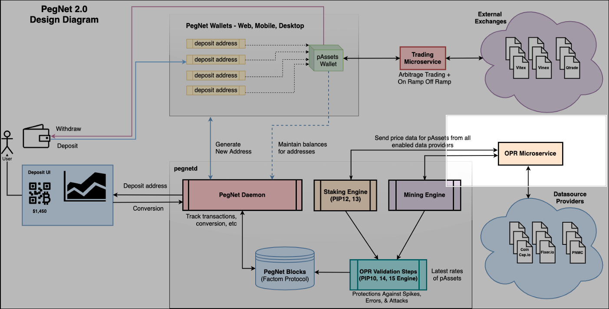

# pegnetorpd
Pegnet OPR Microservice that polls pAssets prices from Oracle(enabled data providers and top 10 exchanges).



### API Documentation
https://documenter.getpostman.com/view/478114/SzzefKqm?version=latest

### CCXT
- **[CCXT](https://github.com/ccxt/ccxt)**&nbsp;&mdash;&nbsp; CryptoCurrency eXchange Trading Library.

pegnetorpd uses CCXT for polling pAssets prices from top 10 external exchanges.

### Oracle Data
| No | Data Source | URL | TYPE |
| --- | --- | --- | --- |
| 1 | Coingecko | https://coingecko.com | Crypto Currency |
| 2 | Coincap.io | https://coincap.io | Crypto Currency |
| 3 | Coinmarketcap | https://coinmarketcap.com | Crypto Currency |
| 4 | Alternative.me | https://alternative.me | Crypto Currency |
| 5 | CryptoCompare | https://cryptocompare.com | Crypto Currency |
| 6 | Exchangeratesapi.io | https://exchangeratesapi.io | Fiat Currency |
| 7 | Factoshi.io | https://factoshi.io | Crypto Currency |
| 8 | Freeforexapi.com | https://www.freeforexapi.com | Fiat Currency |
| 9 | Fixer.io | https://fixer.io | Fiat Currency |
| 10 | Binance | https://www.binance.com | Crypto Currency |
| 11 | Huobi Global | https://www.huobi.com | Crypto Currency |
| 12 | Coinbase Pro | https://pro.coinbase.com | Crypto Currency |
| 13 | Kraken | https://www.kraken.com | Crypto Currency |
| 14 | Bitfinex | https://www.bitfinex.com | Crypto Currency |
| 15 | Bitstamp | https://www.bitstamp.net | Crypto Currency |
| 16 | bitFlyer | http://bitflyer.com | Crypto Currency |
| 17 | Bitbank | https://bitbank.com | Crypto Currency |
| 18 | Bittrex | https://bittrex.com | Crypto Currency |
| 19 | Coinone | https://coinone.co.kr | Crypto Currency |
| 20 | Vitex | https://x.vite.net | Crypto Currency |

### Supported PegAssets
| No | Symbol | Name |
| --- | --- | --- |
| 1 | PEG | PegNet |
| 2 | pUSD | US Dollar |
| 3 | pEUR | Euro |
| 4 | pJPY | Japanese Yen |
| 5 | pGBP | Pound Sterling |
| 6 | pCAD | Canadian Dollar |
| 7 | pCHF | Swiss Franc |
| 8 | pINR | Indian Rupee |
| 9 | pSGD | Singapore Dollar |
| 10 | pCNY | Chinese Yuan |
| 11 | pHKD | Hong Kong Dollar |
| 12 | pKRW | Korean Won |
| 13 | pBRL | Brazil Real |
| 14 | pPHP | Philippine Peso |
| 15 | pMXN | Mexican Peso |
| 16 | pXAU | Silver Troy Ounce |
| 17 | pXAG | Gold Troy Ounce |
| 18 | pXBT | Bitcoin |
| 19 | pETH | Ethereum |
| 20 | pLTC | Litecoin |
| 21 | pRVN | Ravencoin |
| 22 | pXBC | Bitcoin Cash |
| 23 | pFCT | Factom |
| 24 | pBNB | Binance Coin |
| 25 | pXLM | Stellar |
| 26 | pADA | Cardano |
| 27 | pXMR | Monero |
| 28 | pDASH | Dash |
| 29 | pZEC | Zcash |
| 30 | pDCR | Decred |
| 31 | pAUD | Austrailian Dollar |
| 32 | pNZD | New Zealand Dollar |
| 33 | pSEK | Swedish Krona |
| 34 | pNOK | Norwegian Krone |
| 35 | pRUB | Russian Ruble |
| 36 | pZAR | South African Rand |
| 37 | pTRY | Turkish Lira |
| 38 | pEOS | EOS |
| 39 | pLINK | Chainlink |
| 40 | pATOM | Cosmos |
| 41 | pBAT | Basic Attention Token |
| 42 | pXTZ | Tezos |

### Output
- Endpoint: [Server]/api/rates
- Output
```shell
{
  "PEG": {
    "Coingecko": 0.00146778,
    "Coinmarketcap": 0.00135881879228,
    "Factoshi.io": 0.0013482055
  },
  "USD": {
    "Exchangeratesapi.io": 1,
    "Freeforexapi.com": 1,
    "Fixer.io": 1
  },
  "XBT": {
    "Coingecko": 9884.04,
    "Coincap.io": 9889.977199335026,
    "Coinmarketcap": 9905.62300205,
    "Alternative.me": 9884.04,
    "CryptoCompare": 9883.61,
    "Binance": 9878.005000000001,
    "HuobiGlobal": 9877.305,
    "CoinbasePro": 9881.64,
    "Kraken": 9887.9,
    "Bitfinex": 9850.25,
    "Bitstamp": 9882.154999999999,
    "bitFlyer": 9884.04,
    "Bittrex": 9878.26034852
  },
  "ETH": {
    "Coingecko": 247.84,
    "Coincap.io": 247.70588468418683,
    "Coinmarketcap": 248.034185252,
    "Alternative.me": 247.84,
    "CryptoCompare": 247.66,
    "Binance": 247.53,
    "HuobiGlobal": 247.45499999999998,
    "CoinbasePro": 247.595,
    "Kraken": 247.72,
    "Bitfinex": 246.005,
    "Bitstamp": 247.615,
    "Bittrex": 247.55563634499998
  },
  "AUD": {
    "Exchangeratesapi.io": 0.7012946979205766,
    "Freeforexapi.com": 0.7003100272490631,
    "Fixer.io": 0.7019546792277843
  },
  "NZD": {
    "Exchangeratesapi.io": 0.6553551881042964,
    "Freeforexapi.com": 0.654398869198754,
    "Fixer.io": 0.6558879428551371
  },
  "SEK": {
    "Exchangeratesapi.io": 0.10874241193111582,
    "Freeforexapi.com": 0.10901891696247133,
    "Fixer.io": 0.10916948720748262
  }
  ...
}
```
